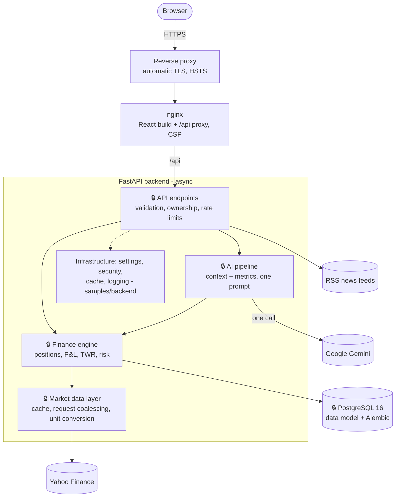

# Yatırım Aklı: AI-Assisted Portfolio Tracker

**Track your equity investments, analyse them, see your risk and have your portfolio explained by AI.**

🇹🇷 **Türkçe:** [README.md](README.md)

> **This is a showcase repository.** The full source code lives in a private repository, and this one is **generated from it automatically** (see [Sync](#sync-and-provenance)). It holds documentation, screenshots and a selection of non-core code samples. The code here is readable but is not a runnable application. Its core-independent tests do run here.

**Contents:** [Problem](#problem) · [Approach](#approach) · [Screenshots](#screenshots) · [Features](#features) · [Architecture](#architecture) · [Design System](#design-system) · [Design Decisions](#design-decisions-and-rationale) · [Results](#results) · [Stack](#stack) · [How It Was Built](#how-it-was-built) · [Security](#security) · [What Is Here](#what-is-and-is-not-here) · [Sync](#sync-and-provenance) · [References](#references)

The detailed documents in [docs/](docs/) are in Turkish.

---

## Problem

Typical portfolio apps show numbers and simple profit/loss percentages. What investors actually need is to understand those numbers: how risky is the portfolio, how does it compare with the market, is it diversified? Many apps also count purchases as "returns", match prices from different exchanges on the wrong days, or mix currencies into a single total.

## Approach

1. **Code computes, the model explains.** Cost basis, P&L, returns and risk metrics come from deterministic code. Google Gemini only explains these precomputed metrics, in Turkish or English.
2. **Financially sound methods.** Performance is a time-weighted return [[3]](#k3). Portfolio volatility uses the covariance matrix [[1]](#k1), and the Sharpe ratio uses a configurable risk-free rate [[2]](#k2). Price series from different exchanges are aligned by date.
3. **An honest interface.** Missing data is shown as "no data". An AI failure is never presented as a report. Every AI text carries its source, its date and a "not investment advice" note.

---

## Screenshots

Taken with a sample portfolio (real market prices, a real Gemini report).

| | |
|---|---|
| **Landing page**  | **Dashboard**  |
| **Portfolio**  | **Transactions**  |
| **Analysis (TWR performance vs. index)**  | **AI commentary**  |
| **Dark theme**  | **English interface**  |

---

## Features

| Area | What it does |
|---|---|
| **Portfolios and transactions** | Multiple portfolios, buy/sell history, weighted average cost (buy commission included), fractional lots. Transactions that would leave the lot balance inconsistent are rejected |
| **Profit / loss** | Unrealised and realised P&L (per sale, holding and portfolio), daily change based on the last trading day. Missing data shows as "no data", never as 0 |
| **Multiple currencies** | Each portfolio has its own currency, and holdings are converted at the current rate. Pence-quoted exchanges such as London are handled in the correct unit |
| **Performance** | Time-weighted return chart compared with BIST-100, S&P 500 or NASDAQ from the same start (1M / 3M / 6M / 1Y / All) |
| **Risk** | Correlation-aware portfolio volatility, Sharpe ratio, beta, maximum drawdown, diversification score, sector breakdown |
| **AI** | Portfolio report, risk report, what-if simulation, rebalancing suggestion, report comparison, streamed (SSE) chat and an assistant available on every page |
| **Alerts and notifications** | Price alerts are checked periodically on the server. A triggered alert raises an in-app notification and a toast |
| **Market** | Watchlist, stock detail page (candlestick chart, fundamentals), Turkish financial news feed |
| **Interface** | Light / dark / system theme, TR / EN, locale-aware numbers and dates, WCAG AA text contrast [[6]](#k6), responsive |

---

## Architecture

Boxes marked 🔒 are the core of the application. Their code is **not** in this repository; they are only described here.

The backend and the database are not exposed, and API keys exist only on the server.

### Finance engine (🔒, described without code)

- **Positions are derived from transactions.** When a transaction is added or deleted, that holding's full history is replayed. A sale is checked against the lots actually held at that point.
- **Correct returns.** Purchases and sales are cash flows, not returns. Performance is a time-weighted return rebuilt from the transaction history and daily closes [[3]](#k3).
- **Correct risk.** Price series are aligned by date, so BIST and US holidays do not get mixed. Portfolio volatility uses the covariance matrix [[1]](#k1), and the Sharpe ratio uses a configurable risk-free rate [[2]](#k2).
- **One door to market data.** A single layer owns market data access: TTL cache, coalescing of concurrent requests, and conversion of minor currency units (pence, cents).

### AI pipeline (🔒, described without code)

- **One call per action.** Every AI feature makes exactly one Gemini call, which keeps latency and quota use low.
- **Nothing made up.** If Gemini fails or the quota runs out, the user sees a clear error and no error text is ever stored as a report.
- **Real streaming.** Chat replies arrive over Server-Sent Events as the model writes them [[7]](#k7). An interrupted reply is not saved.

---

## Design System

The interface aims to look like a calm, trustworthy finance product rather than an "AI demo". The light theme was designed first, and the dark theme was added later as a second set of values under the same token names.

The same page appears below with the same tokens in three looks. Components contain no hard-coded colours, so neither the dark theme nor a language switch needs any change in page code.

| Light theme (default) | Dark theme | English interface |
|---|---|---|
|  |  |  |

| Landing page | Holdings table |
|---|---|
|  |  |

- **One token source.** Colour, radius, typography, spacing and motion are defined only in [`index.css`](samples/frontend/src/index.css), and charts read their colours from the same tokens.
- **Flat surfaces, one accent.** There are white cards and thin borders, with no gradients, glow, glass effects or emoji. The teal accent is used only for small elements such as the logo, active states and focus rings.
- **Numbers that read like finance.** Figures are right-aligned with tabular digits and always carry a currency label. Profit and loss use a sign and ▲▼ as well as colour, so they also work for colour-blind users.
- **Honest states.** Loading, empty and error states are distinct. Missing data says "no data" and is never filled with sample values.
- **AI without decoration.** Every AI text carries a plain "AI analysis" label, its source (Google Gemini), its date and a "not investment advice" note.
- **Measured contrast.** Some proposed colours failed WCAG AA on white, so the up, down, warning and secondary-text tones were darkened until they passed [[6]](#k6).
- **Accessibility audit.** The final audit computed contrast for every text node across two themes and two languages, and checked several screen widths for horizontal overflow. It produced 8 findings, all fixed. One example: text inputs had a 1.45:1 border on white, below the 3:1 that WCAG 1.4.11 requires, and a dedicated token brought it to 3.3:1.
- **Guarded by tests.** [`theme-css.spec.js`](samples/frontend/src/theme-css.spec.js) checks that both themes define the same colour tokens and that form controls take their colours only from tokens, never from hard-coded values or `!important`. [`Modal.spec.jsx`](samples/frontend/src/components/common/Modal.spec.jsx) checks the focus trap, Esc handling and that focus returns to the trigger.

Known limits: not every flow was walked through by keyboard by hand, since modal focus behaviour is covered by tests instead, and the interface has not been tried with a screen reader.

---

## Design Decisions and Rationale

| Decision | Why | Basis |
|---|---|---|
| Performance as time-weighted return (TWR) | Purchases must not count as returns, and the result must be comparable with an index. The old method showed +236% for a portfolio whose TWR was −3.74% | GIPS [[3]](#k3); D-34 |
| Portfolio volatility from the covariance matrix | A weighted average ignores how diversification reduces risk | Markowitz [[1]](#k1); D-32 |
| Sharpe ratio with a configurable risk-free rate | Turkish risk-free rates move too much to hard-code | Sharpe [[2]](#k2); D-32 |
| Price series aligned by date | Matching by row index mixed up holidays across exchanges | D-32 |
| One AI call per action; code does the maths | Latency and quota; the model must not invent numbers | D-04, D-23 |
| AI failure becomes a 503 and is not stored | Error text must never be saved as a report or fed into comparisons | D-21 |
| Streaming over SSE; the full reply is saved only on success | First text in ~0.5–0.7 s; no half-saved replies on disconnect | WHATWG SSE [[7]](#k7); D-30 |
| Access token in memory; refresh token in an httpOnly cookie, stored server-side and rotated on every refresh | Tokens cannot be stolen via XSS, and reusing a stolen token revokes the session family | RFC 7519 [[4]](#k4), RFC 9700 [[5]](#k5); D-28 |
| Schema managed only by Alembic migrations | `create_all` does not alter existing tables, and a test catches model/schema drift | D-02 |
| Tests on real PostgreSQL, no network | SQLite would hide bugs that come from real type behaviour | D-12 |
| Single-source design tokens; colours chosen by measured contrast | Light and dark themes share token names; text contrast meets AA | WCAG 2.1 [[6]](#k6); D-38 |
| Dependency-free i18n; exactly pinned packages | No unnecessary libraries; reproducible builds | D-13, D-41 |

---

## Results

These figures come from the private repository's CI records (GitHub Actions, the latest green run on `main`). Nothing here is a hand-written measurement.

| Metric | Result |
|---|---|
| Backend tests (pytest, real PostgreSQL, no network) | 612 passed |
| Frontend component tests (Vitest + Testing Library) | 38 passed (8 files) |
| Frontend pure-logic tests (`node --test`) | 44 pass, 0 fail |
| ESLint | 0 errors, 0 warnings |
| Accessibility audit | two themes × two languages, computed contrast for every text node; 8 findings, 8 fixes |

This repository's own CI also lints the samples and runs the core-independent tests on every push ([.github/workflows/ci.yml](.github/workflows/ci.yml)).

---

## Stack

| Layer | Technology |
|---|---|
| **Frontend** | React 19, Vite, Zustand, React Router, ApexCharts, Axios, react-markdown, dependency-free i18n |
| **Backend** | Python 3.12, FastAPI (async), SQLAlchemy 2 + asyncpg, Alembic, Pydantic |
| **Database** | PostgreSQL 16 |
| **AI** | Google Gemini, `google-genai` SDK (async, SSE streaming) |
| **Data** | yfinance, Turkish financial RSS feeds |
| **Auth** | JWT, bcrypt |
| **Infrastructure** | Docker Compose, nginx, reverse proxy with automatic TLS |
| **Quality** | pytest, Vitest + Testing Library, ESLint, GitHub Actions |

---

## How It Was Built

The project started from a flawed v1.0.0 demo, and the first step was an **audit** rather than new code. Every issue found became a numbered record (42 in total), and every architectural decision was written down with the alternatives it beat. The work then followed technical dependencies:

1. Test foundation
2. Data correctness
3. Security
4. AI reliability
5. Missing features
6. Clean-up and operations
7. Design overhaul and accessibility
8. TR / EN support
9. Frontend tests

The rules were: one task at a time, a failing test before any behaviour change, atomic commits, no fake data, and a measurable exit gate for every phase.

---

## Security

| Topic | Measure |
|---|---|
| **Secrets** | Keys and passwords live only in the server's `.env`; the repository holds an empty example ([samples/.env.example](samples/.env.example)). The app refuses to start with weak or placeholder values ([samples/backend/app/config.py](samples/backend/app/config.py)) |
| **Sessions** | bcrypt. The short-lived access token is kept in memory only. The `HttpOnly` + `SameSite=Strict` refresh cookie is stored server-side and rotated on every refresh, and reusing a stolen token revokes the session [[5]](#k5) |
| **Abuse** | Rate limits on login, registration, refresh and AI endpoints, a temporary lock after failed logins, and constant work to prevent timing-based user enumeration |
| **Network** | Backend and database are never exposed; HTTPS + HSTS |
| **Browser** | Strict Content-Security-Policy and security headers; no raw HTML in AI output |
| **Logging** | Query strings, headers and bodies are never logged ([samples/backend/app/utils/request_logging.py](samples/backend/app/utils/request_logging.py)) |

---

## What Is and Is Not Here

| Here | Not here (private repository) |
|---|---|
| This README, [LICENSE](LICENSE), showcase documents in [docs/](docs/) | Internal documents and the full issue log |
| [screenshots/](screenshots/) | Deployment configuration |
| [samples/frontend/](samples/frontend/): design tokens, shared components, TR/EN i18n, their tests, lint and test setup | Pages, charts, API client, P&L and risk helpers |
| [samples/backend/](samples/backend/): settings and validation, security (passwords, JWT), cache, logging, their tests | 🔒 API endpoints, finance engine, AI service and prompts, market data layer, data model, migrations |
| [samples/docker-compose.yml](samples/docker-compose.yml), [samples/.env.example](samples/.env.example) | Real environment values, keys, database backups |
| This repository's own CI ([.github/workflows/ci.yml](.github/workflows/ci.yml)) | Core-dependent tests (always run in the private repository) |
| [PROVENANCE.md](PROVENANCE.md) | The private repository's git history |

---

## Sync and Provenance

Nobody edits this repository by hand. When CI on the private repository's `main` branch goes green, a workflow there:

1. Reads an **allow-list**. Only files named one by one can be published; there are no folders and no wildcards.
2. Reads each file **from the commit, not from disk**, so a file that was never committed (such as `.env`) cannot be published.
3. Runs four layers of checks: the allow-list, a deny-list, a secret scan and a scan for core-specific identifiers. If any check fails, **no file is written**.
4. Replays the private commits in order. Only commits that change this repository become commits here, keeping their original subject and date. Instead of the original body, the commit message lists the changed files and the source commit.
5. Never force-pushes, and pushes with a deploy key that can write to this repository only.

[PROVENANCE.md](PROVENANCE.md) is rewritten on every sync. It records the source commit, its date, the file count and a SHA-256 for every file, so each file here can be traced to the exact private commit it came from.

---

## References

1. Markowitz, H. (1952). Portfolio Selection. *The Journal of Finance*, 7(1), 77–91. Basis for computing portfolio variance from the covariance matrix.
2. Sharpe, W. F. (1994). The Sharpe Ratio. *The Journal of Portfolio Management*, 21(1), 49–58. Definition of the Sharpe metric: excess return over the risk-free rate per unit of volatility.
3. CFA Institute. *Global Investment Performance Standards (GIPS®)*. https://www.gipsstandards.org/ The time-weighted return standard in performance reporting, which is the basis for choosing TWR.
4. Jones, M., Bradley, J., Sakimura, N. (2015). *JSON Web Token (JWT)*. RFC 7519. https://www.rfc-editor.org/rfc/rfc7519 Format of the access and refresh tokens.
5. Lodderstedt, T., Bradley, J., Labunets, A., Fett, D. (2025). *Best Current Practice for OAuth 2.0 Security*. RFC 9700. https://www.rfc-editor.org/rfc/rfc9700 Refresh token rotation and reuse detection.
6. W3C (2018). *Web Content Accessibility Guidelines (WCAG) 2.1*, criteria 1.4.3 and 1.4.11. https://www.w3.org/TR/WCAG21/ Contrast thresholds for text (4.5:1) and non-text elements (3:1), used as the audit criteria.
7. WHATWG. *HTML Living Standard: Server-sent events*. https://html.spec.whatwg.org/multipage/server-sent-events.html Event format of the streamed chat replies.

---

**Disclaimer:** This application does not give investment advice. AI-generated commentary is for information only.

**License:** © 2026 Halit Kılıç ([@kilicchalitt](https://github.com/kilicchalitt)). All rights reserved. This repository is published for viewing only. Its content may not be copied, modified, distributed or used without written permission. See [LICENSE](LICENSE).
