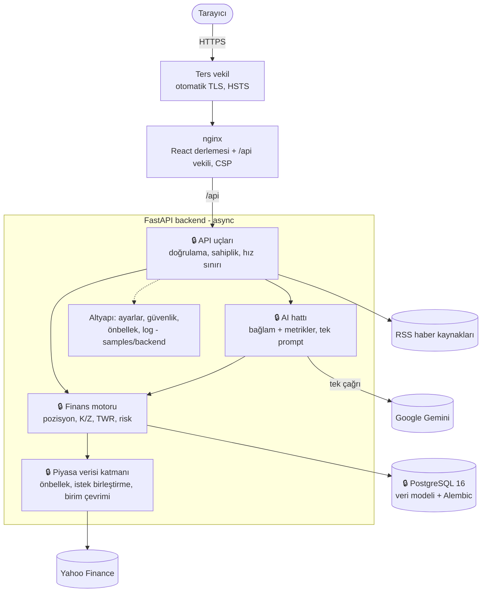

# Yatırım Aklı: AI Destekli Portföy Takip Sistemi

**Borsa yatırımlarınızı takip edin, analiz edin, risklerinizi görün ve yapay zekâ ile portföyünüzü yorumlayın.**

🇬🇧 **English:** [README.en.md](README.en.md)

> **Bu bir tanıtım (vitrin) deposudur.** Uygulamanın tam kaynak kodu özel bir depoda tutulur. Bu depo o depodan **otomatik üretilir** (bkz. [Eşitleme](#eşitleme-ve-provenance)): belgeler, ekran görüntüleri ve çekirdek olmayan seçilmiş kod örnekleri. Buradaki kod okunabilir ama tek başına çalışan bir uygulama değildir; çekirdekten bağımsız testleri bu depoda da koşar.

**İçindekiler:** [Problem](#problem) · [Yaklaşım](#yaklaşım) · [Ekran Görüntüleri](#ekran-görüntüleri) · [Özellikler](#özellikler) · [Mimari](#mimari) · [Tasarım Kararları](#tasarım-kararları-ve-gerekçeleri) · [Sonuçlar](#sonuçlar) · [Teknolojiler](#teknolojiler) · [Geliştirme Süreci](#geliştirme-süreci) · [Güvenlik](#güvenlik) · [Bu Depoda Ne Var, Ne Yok](#bu-depoda-ne-var-ne-yok) · [Eşitleme](#eşitleme-ve-provenance) · [Kaynakça](#kaynakça)

---

## Problem

Geleneksel portföy uygulamaları çoğunlukla sayılar ve basit kâr/zarar oranları sunar. Yatırımcının asıl ihtiyacı ise bu sayıların ne anlama geldiğini görmek: portföy ne kadar riskli, getiri piyasaya göre nasıl, dağılım dengeli mi? Üstelik birçok uygulamada alımlar "getiri" gibi görünür, farklı borsaların fiyatları yanlış günlerle eşleşir ve farklı para birimleri tek bir toplamda karışır.

**Hedef kitle:** Portföyünü tek yerden izlemek isteyen bireysel yatırımcılar ve risk yönetimini öğrenmek isteyen başlangıç / orta düzey yatırımcılar.

## Yaklaşım

1. **Sayıları kod hesaplar, model yorumlar.** Maliyet, kâr/zarar, getiri ve risk metrikleri deterministik kodla hesaplanır; Google Gemini yalnız bu hazır metrikleri seçili dilde (TR/EN) yorumlar.
2. **Finansal olarak doğru yöntemler.** Performans zaman ağırlıklı getiri (TWR) ile [[3]](#k3), portföy volatilitesi hisseler arası kovaryansla [[1]](#k1), Sharpe oranı risksiz faizle [[2]](#k2) hesaplanır; farklı borsaların fiyat serileri tarihe göre hizalanır.
3. **Dürüst arayüz.** Veri yoksa "veri yok" denir; AI hatası rapor gibi gösterilmez; her AI metni kaynak, tarih ve "yatırım tavsiyesi değildir" notu taşır.

---

## Ekran Görüntüleri

Örnek bir portföyle alınmıştır (gerçek piyasa fiyatları, gerçek Gemini raporu).

| | |
|---|---|
| **Tanıtım sayfası**  | **Gösterge Paneli**  |
| **Portföy**  | **İşlemler**  |
| **Analiz (TWR performansı, endeks karşılaştırması)**  | **Yapay zekâ yorumu**  |
| **Koyu tema**  | **İngilizce arayüz**  |

---

## Özellikler

| Alan | Neler var |
|---|---|
| **Portföy ve işlemler** | Birden çok portföy, alım-satım geçmişi, ağırlıklı ortalama maliyet (alış komisyonu dahil), kesirli lot. Lot bakiyesini tutarsız bırakacak işlemler reddedilir |
| **Kâr / zarar** | Gerçekleşmemiş ve gerçekleşen kâr/zarar (satış, hisse ve portföy düzeyinde), son işlem gününe göre günlük değişim. Veri yoksa "0" değil "Veri yok" |
| **Çoklu para birimi** | Her portföyün kendi para birimi; farklı para birimli hisseler güncel kurla çevrilir. Londra gibi pence ile fiyatlanan borsalar doğru birimde |
| **Performans** | Zaman ağırlıklı getiri (TWR) grafiği; BIST-100, S&P 500 veya NASDAQ ile aynı başlangıçtan karşılaştırma (1A / 3A / 6A / 1Y / Tümü) |
| **Risk** | Korelasyonu hesaba katan portföy volatilitesi, Sharpe oranı, beta, maksimum düşüş, çeşitlendirme skoru, sektör dağılımı |
| **Yapay zekâ** | Portföy raporu, risk raporu, "ya şunu alsaydım" (what-if) simülasyonu, dengeleme önerisi, rapor karşılaştırma, akan (SSE) sohbet ve her sayfadan erişilen asistan |
| **Alarmlar ve bildirimler** | Hedef fiyat alarmları sunucuda periyodik kontrol edilir; tetiklenince uygulama içi bildirim ve toast |
| **Piyasa** | İzleme listesi, hisse detayı (mum grafiği, temel veriler), Türkçe finans haber akışı |
| **Arayüz** | Açık / koyu / sistem teması, TR / EN dil, dile göre sayı ve tarih biçimleri, WCAG AA metin kontrastı [[6]](#k6), mobil uyumlu |

---

## Mimari

🔒 işaretli kutular uygulamanın çekirdeğidir; kodları bu depoda **yoktur**, yalnız burada anlatılır.

Backend ve veritabanı dışarıya kapalıdır; API anahtarları yalnız sunucuda bulunur. Ayrıntı: [docs/ARCHITECTURE.md](docs/ARCHITECTURE.md).

### Finans motoru (🔒, kodsuz anlatım)

- **Pozisyonlar işlemlerden türetilir.** Bir işlem eklendiğinde ya da silindiğinde o hissenin tüm geçmişi yeniden oynatılır; satıştan önce "eldekinden fazla satış" kontrol edilir.
- **Doğru getiri.** Alım ve satımlar nakit akışıdır, getiri değildir. Performans, işlem geçmişi ve günlük kapanışlardan zaman ağırlıklı getiri olarak hesaplanır [[3]](#k3).
- **Doğru risk.** Fiyat serileri tarihe göre hizalanır (BIST ve ABD tatilleri karışmaz); portföy volatilitesi kovaryans matrisiyle [[1]](#k1), Sharpe oranı ayarlanabilir risksiz faizle [[2]](#k2) hesaplanır.
- **Tek veri kapısı.** Piyasa verisine tek bir katmandan gidilir: süreli önbellek, aynı anda gelen istekleri birleştirme, küçük para birimlerini (pence, cent) ana birime çevirme.

### Yapay zekâ hattı (🔒, kodsuz anlatım)

- **Eylem başına tek çağrı.** Her AI özelliği tek bir Gemini çağrısı yapar; gecikme ve kota düşük kalır.
- **Uydurma yok.** Gemini hata verirse ya da kota dolarsa kullanıcıya açık bir hata gösterilir; hiçbir hata metni rapor gibi kaydedilmez.
- **Gerçek akış.** Sohbet yanıtı model yazdıkça Server-Sent Events ile parça parça gelir [[7]](#k7); yarıda kalan yanıt kaydedilmez.

---

## Tasarım Kararları ve Gerekçeleri

| Karar | Neden | Dayanak |
|---|---|---|
| Performans zaman ağırlıklı getiriyle (TWR) | Alımlar getiri sayılmasın; sonuç yatırılan tutardan bağımsız ve endeksle karşılaştırılabilir olsun. Eski yöntem aynı portföy için +%236, TWR −%3,74 gösterdi | GIPS [[3]](#k3); D-34 |
| Portföy volatilitesi kovaryans matrisiyle | Ağırlıklı ortalama, çeşitlendirmenin riski azaltan etkisini yok sayar | Markowitz [[1]](#k1); D-32 |
| Sharpe oranı ayarlanabilir risksiz faizle | Türkiye'de risksiz faiz sabit kabul edilemeyecek kadar oynak | Sharpe [[2]](#k2); D-32 |
| Fiyat serileri tarihe göre hizalanır | Sıra numarasıyla eşleme, farklı borsaların farklı tatil günlerini karıştırıyordu | D-32 |
| AI eylem başına tek çağrı; sayıları kod hesaplar | Gecikme ve kota; modelin sayı uydurmasını önlemek | D-04, D-23 |
| AI hatası 503 olur, kaydedilmez | Hata metni rapor gibi saklanıp karşılaştırmalara girmesin | D-21 |
| Akan yanıt SSE ile, tam yanıt yalnız başarıda kaydedilir | İlk metin ~0,5–0,7 sn; kopan bağlantıda yarım kayıt yok | WHATWG SSE [[7]](#k7); D-30 |
| Access token bellekte, refresh token httpOnly cookie'de, sunucuda kayıtlı ve her yenilemede döner | XSS'te token çalınmasın; çalıntı token'ın tekrar kullanımı oturum ailesini iptal etsin | RFC 7519 [[4]](#k4), RFC 9700 [[5]](#k5); D-28 |
| Şema yalnız Alembic migration'larıyla | `create_all` mevcut tabloları değiştirmez; modeller ile şema arasındaki farkı bir test yakalar | D-02 |
| Testler gerçek PostgreSQL'de, ağsız | SQLite gibi bir yedek, gerçek tip davranışından doğan hataları gizlerdi | D-12 |
| Tek token kaynaklı tasarım sistemi, kontrast ölçülerek seçilen renkler | Açık ve koyu tema aynı token adlarıyla; metin kontrastı AA | WCAG 2.1 [[6]](#k6); D-38 |
| Bağımlılıksız i18n, tam sürüme sabitli paketler | Gereksiz bağımlılık yok; derleme her yerde aynı sürümlerle | D-13, D-41 |

Kararların tamamı ve elenen alternatifler: [docs/DECISIONS.md](docs/DECISIONS.md).

---

## Sonuçlar

Aşağıdaki sayılar ana projenin CI kayıtlarından alınmıştır (GitHub Actions, `main` dalının son yeşil koşusu); elle yazılmış bir ölçüm yoktur.

| Ölçüt | Sonuç |
|---|---|
| Backend testleri (pytest, gerçek PostgreSQL, ağ yok) | 612 passed |
| Frontend bileşen testleri (Vitest + Testing Library) | 38 passed (8 dosya) |
| Frontend saf mantık testleri (`node --test`) | 44 pass, 0 fail |
| ESLint | 0 hata, 0 uyarı |
| Erişilebilirlik denetimi | iki tema × iki dil, her metin düğümünde hesaplanan kontrast; 8 bulgu, 8 düzeltme ([docs/DESIGN.md](docs/DESIGN.md)) |

Bu depodaki örneklerin kendi CI'ı da her gönderimde lint ve çekirdekten bağımsız testleri çalıştırır ([.github/workflows/ci.yml](.github/workflows/ci.yml)).

---

## Teknolojiler

| Katman | Teknoloji |
|---|---|
| **Frontend** | React 19, Vite, Zustand, React Router, ApexCharts, Axios, react-markdown, kütüphanesiz i18n |
| **Backend** | Python 3.12, FastAPI (async), SQLAlchemy 2 + asyncpg, Alembic, Pydantic |
| **Veritabanı** | PostgreSQL 16 |
| **Yapay zekâ** | Google Gemini, `google-genai` SDK (async, SSE akışı) |
| **Veri** | yfinance, Türkçe finans RSS kaynakları |
| **Kimlik doğrulama** | JWT, bcrypt |
| **Altyapı** | Docker Compose, nginx, otomatik TLS'li ters vekil |
| **Kalite** | pytest, Vitest + Testing Library, ESLint, GitHub Actions |

---

## Geliştirme Süreci

Proje, sorunları olan bir v1.0.0 demosundan başladı. İlk adım kod yazmak değil **denetim** oldu: bulunan her sorun numaralı bir kayıt oldu (toplam 42), her mimari karar elenen alternatifleriyle birlikte yazıldı. Ardından iş teknik bağımlılık sırasıyla ilerledi:

1. Test zemini
2. Veri doğruluğu
3. Güvenlik
4. AI güvenilirliği
5. Eksik özellikler
6. Temizlik ve operasyon
7. Tasarım yenilemesi ve erişilebilirlik
8. TR / EN dil desteği
9. Frontend testleri

Kurallar: her adımda tek görev, davranış değiştirmeden önce başarısız bir test, atomik commit'ler, sahte veri yok, her aşamanın ölçülebilir bir çıkış kapısı.

- [docs/DEVELOPMENT_JOURNEY.md](docs/DEVELOPMENT_JOURNEY.md): aşamalar ve örnek bir hata hikâyesi
- [docs/DECISIONS.md](docs/DECISIONS.md): seçilmiş mühendislik kararları
- [docs/DESIGN.md](docs/DESIGN.md): tasarım sistemi ve erişilebilirlik denetimi
- [docs/LIMITATIONS.md](docs/LIMITATIONS.md): bilinen sınırlar ve çözülen sorunlar

---

## Güvenlik

| Konu | Önlem |
|---|---|
| **Gizli bilgiler** | Anahtar ve şifreler yalnız sunucudaki `.env` dosyasında; depoda yalnız boş örnek ([samples/.env.example](samples/.env.example)). Zayıf ya da örnek değerle uygulama başlamaz ([samples/backend/app/config.py](samples/backend/app/config.py)) |
| **Oturum** | bcrypt; kısa ömürlü access token yalnız bellekte; sunucuda kayıtlı, her yenilemede dönen `HttpOnly` + `SameSite=Strict` refresh cookie; çalıntı token'ın tekrar kullanımı oturumu iptal eder [[5]](#k5) |
| **Kötüye kullanım** | Giriş, kayıt, yenileme ve AI uç noktalarında hız sınırı; hatalı girişte geçici kilit; zamanlama ile kullanıcı tespitine karşı her durumda aynı iş |
| **Ağ** | Backend ve veritabanı host'a açılmaz; HTTPS + HSTS |
| **Tarayıcı** | Sıkı Content-Security-Policy, güvenlik başlıkları; AI çıktısında ham HTML yok |
| **Log** | Sorgu dizesi, başlık ve gövde loglanmaz ([samples/backend/app/utils/request_logging.py](samples/backend/app/utils/request_logging.py)) |

---

## Bu Depoda Ne Var, Ne Yok

| Var | Yok (özel depoda) |
|---|---|
| Bu README, [LICENSE](LICENSE), [docs/](docs/) altındaki vitrin belgeleri | Ana projenin iç belgeleri ve sorun kayıtlarının tamamı |
| [screenshots/](screenshots/) | Canlıya alma yapılandırması |
| [samples/frontend/](samples/frontend/): tasarım token'ları, ortak bileşenler, TR/EN i18n, testleri, lint ve test ayarı | Sayfalar, grafikler, API istemcisi, kâr/zarar ve risk yardımcıları |
| [samples/backend/](samples/backend/): ayarlar ve doğrulaması, güvenlik (parola, JWT), önbellek, log ve testleri | 🔒 API uçları, finans motoru, AI servisi ve prompt'lar, piyasa verisi katmanı, veri modeli, migration'lar |
| [samples/docker-compose.yml](samples/docker-compose.yml), [samples/.env.example](samples/.env.example) | Gerçek ortam değişkenleri, anahtarlar, veritabanı yedekleri |
| Bu deponun kendi CI'ı ([.github/workflows/ci.yml](.github/workflows/ci.yml)) | Çekirdeğe bağlı testler (ana projede her zaman koşar) |
| [PROVENANCE.md](PROVENANCE.md) | Ana projenin git geçmişi |

Örneklerin ayrıntılı listesi: [samples/README.md](samples/README.md).

---

## Eşitleme ve PROVENANCE

Bu depo elle güncellenmez. Ana projenin `main` dalındaki CI yeşil bittiğinde, ana projedeki bir iş akışı:

1. Ana projedeki **izin listesini** okur: vitrine yalnız tek tek adı yazılmış dosyalar çıkar (klasör ya da joker yok).
2. Dosyaları **diskten değil commit'ten** okur; git'e girmemiş hiçbir dosya (ör. `.env`) çıkamaz.
3. Dört katmanlı denetimden geçirir: izin listesi, yasak liste, gizli bilgi taraması ve çekirdeğe ait ifadelerin taraması. Herhangi bir ihlalde **hiçbir dosya yazılmaz**.
4. Ana projedeki her commit'i sırayla aktarır. Yalnız bu depoyu etkileyen commit'ler, orijinal konu satırı ve tarihiyle burada bir commit olur; gövde yerine değişen dosyalar ve kaynak commit yazılır.
5. Zorla gönderim (force push) kullanmaz; yalnız tek bir depoya yazabilen bir dağıtım anahtarıyla gönderir.

[PROVENANCE.md](PROVENANCE.md) her eşitlemede yeniden yazılır: kaynak commit, tarih, dosya sayısı ve her dosyanın SHA-256 özeti. Bu sayede buradaki her dosyanın ana projedeki hangi commit'ten geldiği doğrulanabilir.

---

## Kaynakça

1. Markowitz, H. (1952). Portfolio Selection. *The Journal of Finance*, 7(1), 77–91. — Portföy varyansının kovaryans matrisiyle hesaplanması; portföy volatilitesinin dayanağı.
2. Sharpe, W. F. (1994). The Sharpe Ratio. *The Journal of Portfolio Management*, 21(1), 49–58. — Risksiz faize göre fazla getirinin oynaklığa oranı; Sharpe metriğinin tanımı.
3. CFA Institute. *Global Investment Performance Standards (GIPS®)*. https://www.gipsstandards.org/ — Performans raporlamasında zaman ağırlıklı getiri standardı; TWR seçiminin dayanağı.
4. Jones, M., Bradley, J., Sakimura, N. (2015). *JSON Web Token (JWT)*. RFC 7519. https://www.rfc-editor.org/rfc/rfc7519 — Access ve refresh token biçimi.
5. Lodderstedt, T., Bradley, J., Labunets, A., Fett, D. (2025). *Best Current Practice for OAuth 2.0 Security*. RFC 9700. https://www.rfc-editor.org/rfc/rfc9700 — Refresh token rotasyonu ve tekrar kullanım tespiti.
6. W3C (2018). *Web Content Accessibility Guidelines (WCAG) 2.1*, ölçütler 1.4.3 ve 1.4.11. https://www.w3.org/TR/WCAG21/ — Metin (4.5:1) ve metin dışı öğe (3:1) kontrast eşikleri; tasarım denetiminin ölçütleri.
7. WHATWG. *HTML Living Standard: Server-sent events*. https://html.spec.whatwg.org/multipage/server-sent-events.html — Akan sohbet yanıtlarının olay biçimi.

---

**Yasal uyarı:** Bu uygulama yatırım tavsiyesi vermez. Yapay zekâ tarafından üretilen yorumlar bilgilendirme amaçlıdır.

**Lisans:** © 2026 Halit Kılıç ([@kilicchalitt](https://github.com/kilicchalitt)). Tüm hakları saklıdır. Bu depo yalnızca incelemek amacıyla yayımlanmıştır; içeriği yazılı izin olmadan kopyalanamaz, değiştirilemez, dağıtılamaz ve kullanılamaz. Ayrıntılar: [LICENSE](LICENSE).
