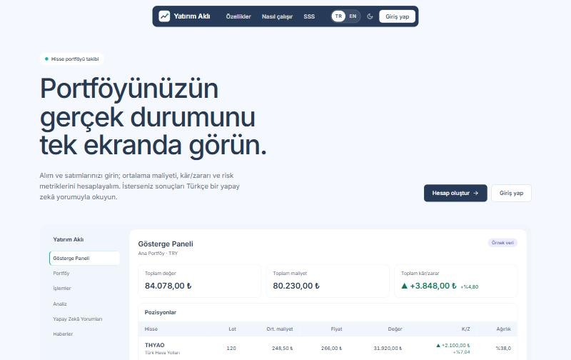
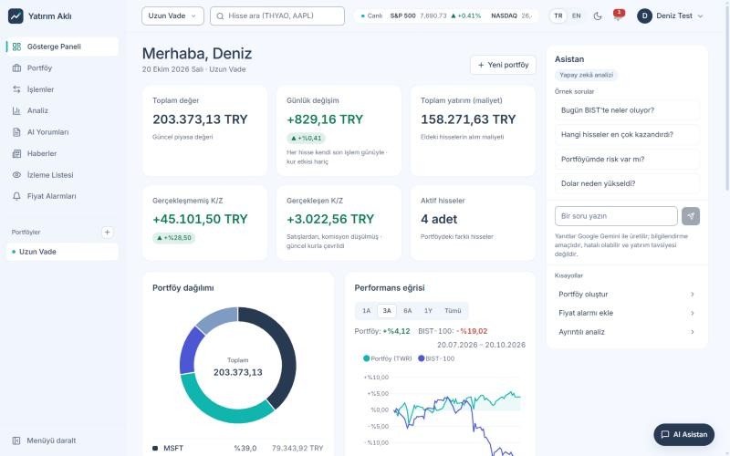
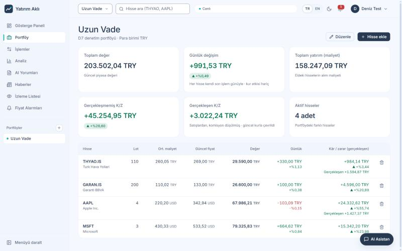
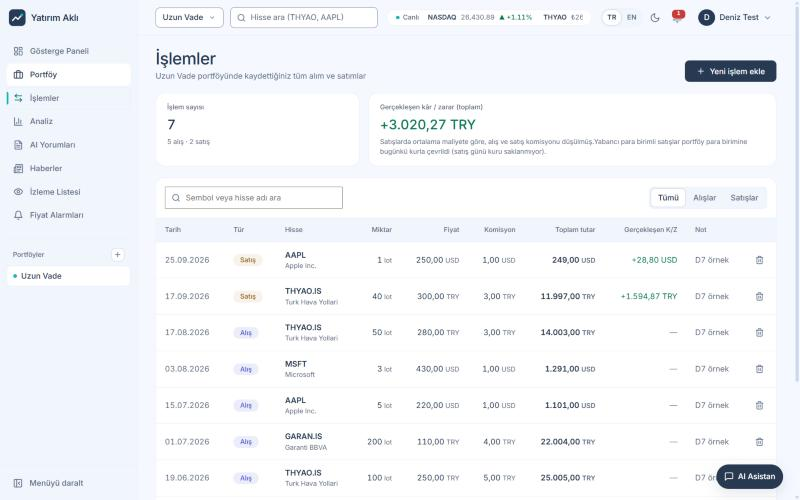
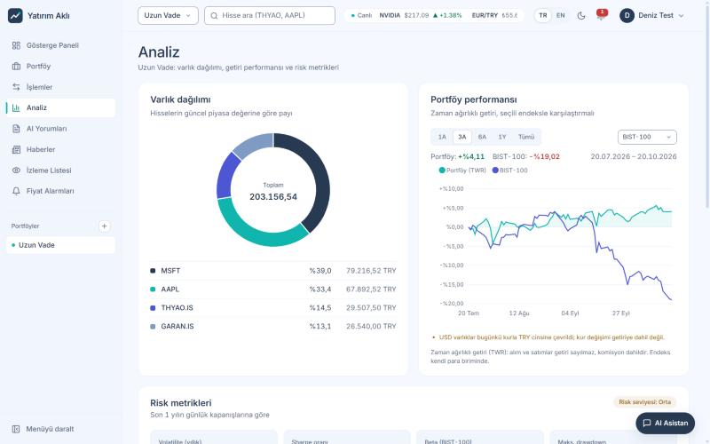
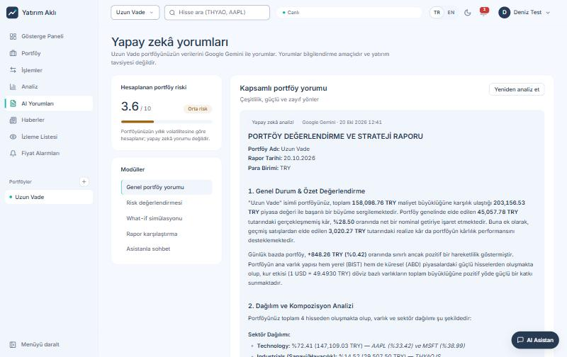
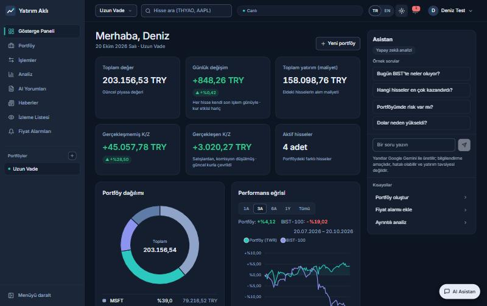
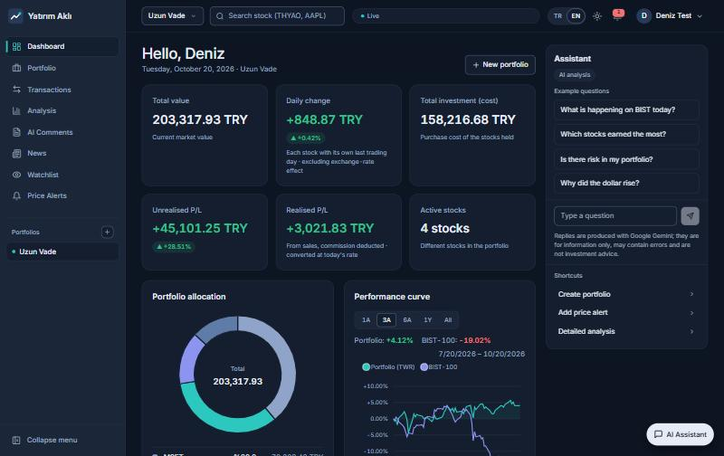

# Yatırım Aklı: AI Destekli Portföy Takip Sistemi

**Borsa yatırımlarınızı takip edin, analiz edin, risklerinizi görün ve yapay zekâ ile portföyünüzü yorumlayın.**


> **Bu bir tanıtım (vitrin) deposudur.** Uygulamanın tam kaynak kodu özel bir depoda tutulmaktadır. Burada projenin ne yaptığı, nasıl tasarlandığı, hangi kararlarla ve nasıl bir süreçle geliştirildiği anlatılır; [`samples/`](samples/) klasöründe çekirdek olmayan seçilmiş kod örnekleri bulunur.

**İçindekiler:** [Proje Hakkında](#proje-hakkında) · [Ekran Görüntüleri](#ekran-görüntüleri) · [Özellikler](#özellikler) · [Nasıl Çalışır](#nasıl-çalışır) · [Mimari](#mimari) · [Teknolojiler](#teknolojiler) · [Geliştirme Süreci](#geliştirme-süreci) · [Güvenlik](#güvenlik) · [Bu Depoda Ne Var](#bu-depoda-ne-var) · [English](#english-summary)

---

## Proje Hakkında

Geleneksel portföy uygulamaları çoğunlukla sayılar ve basit kâr/zarar oranları sunar. Yatırımcının asıl ihtiyacı ise bu sayıların ne anlama geldiğini görmek: portföy ne kadar riskli, getiri piyasaya göre nasıl, dağılım dengeli mi?

**Yatırım Aklı**, BIST ve yurt dışı hisselerini tek yerde takip eder; maliyet, kâr/zarar, risk ve performansı doğru hesaplar ve bu sonuçları **Google Gemini** ile Türkçe ya da İngilizce olarak yorumlar.

**Hedef kitle:** Portföyünü tek yerden izlemek isteyen bireysel yatırımcılar ve risk yönetimini öğrenmek isteyen başlangıç / orta düzey yatırımcılar.

---

## Ekran Görüntüleri

Örnek bir portföyle alınmıştır (gerçek piyasa fiyatları, gerçek Gemini raporu).

| | |
|---|---|
| **Tanıtım sayfası**<br> | **Gösterge Paneli**<br> |
| **Portföy**<br> | **İşlemler**<br> |
| **Analiz (TWR performansı, endeks karşılaştırması)**<br> | **Yapay zekâ yorumu**<br> |
| **Koyu tema**<br> | **İngilizce arayüz**<br> |

---

## Özellikler

| Alan | Neler var |
|---|---|
| **Portföy ve işlemler** | Birden çok portföy, alım-satım geçmişi, ağırlıklı ortalama maliyet (alış komisyonu dahil), kesirli lot. Lot bakiyesini tutarsız bırakacak işlemler reddedilir |
| **Kâr / zarar** | Gerçekleşmemiş ve gerçekleşen kâr/zarar (satış, hisse ve portföy düzeyinde), son işlem gününe göre günlük değişim. Veri yoksa "0" değil "Veri yok" |
| **Çoklu para birimi** | Her portföyün kendi para birimi; farklı para birimli hisseler güncel kurla çevrilir. Londra gibi pence ile fiyatlanan borsalar doğru birimde |
| **Performans** | Zaman ağırlıklı getiri (TWR) grafiği; BIST-100, S&P 500 veya NASDAQ ile aynı başlangıçtan karşılaştırma (1A / 3A / 6A / 1Y / Tümü) |
| **Risk** | Korelasyonu hesaba katan portföy volatilitesi, Sharpe oranı, beta, maksimum düşüş, çeşitlendirme skoru, sektör dağılımı |
| **Yapay zekâ** | Portföy raporu, risk raporu, "ya şunu alsaydım" (what-if) simülasyonu, dengeleme önerisi, rapor karşılaştırma, akan (SSE) sohbet ve her sayfadan erişilen asistan |
| **Alarmlar ve bildirimler** | Hedef fiyat alarmları sunucuda periyodik kontrol edilir; tetiklenince uygulama içi bildirim ve toast |
| **Piyasa** | İzleme listesi, hisse detayı (mum grafiği, temel veriler), Türkçe finans haber akışı |
| **Arayüz** | Açık / koyu / sistem teması, TR / EN dil, dile göre sayı ve tarih biçimleri, WCAG AA metin kontrastı, mobil uyumlu |

---

## Nasıl Çalışır

Uygulamanın iki çekirdek parçası var. Kodları bu depoda yok; burada ne yaptıkları anlatılır.

### 1. Finans motoru

```
İşlem geçmişi ──► pozisyonlar (lot, ortalama maliyet)
      │                      │
      │          güncel fiyat (60 sn önbellek) + güncel kur
      │                      │
      ▼                      ▼
günlük kapanışlar ──► değer serisi ──► TWR, volatilite, Sharpe, beta, maks. düşüş
```

- **Pozisyonlar işlemlerden türetilir.** Bir işlem eklendiğinde ya da silindiğinde o hissenin tüm geçmişi yeniden oynatılır; satıştan önce "eldekinden fazla satış" kontrol edilir.
- **Doğru getiri.** Alım ve satımlar nakit akışıdır, getiri değildir. Performans, işlem geçmişi ve günlük kapanışlardan **zaman ağırlıklı getiri** olarak hesaplanır. Bu düzeltmeden önce aynı portföy için grafik +%236 gösteriyordu; gerçek getiri −%3,74'tü.
- **Doğru risk.** Farklı borsaların fiyat serileri tarihe göre hizalanır (BIST ve ABD tatilleri karışmaz); portföy volatilitesi hisseler arası korelasyonu hesaba katar.
- **Tek veri kapısı.** Piyasa verisine tek bir katmandan gidilir: süreli önbellek, aynı anda gelen istekleri birleştirme, küçük para birimlerini (pence, cent) ana birime çevirme.

### 2. Yapay zekâ hattı

```
Kullanıcı isteği
      │
      ▼
Portföy bağlamı (hisseler, güncel fiyatlar, kur)
      +
Hesaplanan metrikler (performans, dağılım, risk) ── paralel
      │
      ▼
Tek prompt ──► Gemini ──► seçili dilde rapor ──► kaydedilir
```

- **Eylem başına tek çağrı.** Her AI özelliği tek bir Gemini çağrısı yapar; bu, gecikmeyi ve kota kullanımını düşük tutar.
- **Sayıları model değil, kod hesaplar.** Model yalnızca önceden hesaplanmış metrikleri yorumlar.
- **Uydurma yok.** Gemini hata verirse ya da kota dolarsa kullanıcıya açık bir hata gösterilir; hiçbir hata metni rapor gibi kaydedilmez.
- **Gerçek akış.** Sohbet yanıtı model yazdıkça parça parça gelir (ilk metin ~0,5–0,7 sn). Yarıda kalan yanıt kaydedilmez.
- **Dürüst sunum.** Her AI metni kaynak, tarih ve "yatırım tavsiyesi değildir" notuyla gösterilir.

---

## Mimari

```
                 İnternet (80/443)
                        │
                ┌───────▼───────┐
                │ Ters vekil    │   otomatik TLS, HTTP→HTTPS, HSTS
                └───────┬───────┘
                ┌───────▼───────┐
                │ nginx         │   React derlemesi + /api ters vekil, CSP
                └───────┬───────┘
                ┌───────▼───────┐        ┌──────────────────────────┐
                │ FastAPI       │───────►│ Google Gemini            │
                │ (async)       │───────►│ Yahoo Finance (yfinance) │
                │               │───────►│ RSS haber kaynakları     │
                └───────┬───────┘        └──────────────────────────┘
                ┌───────▼───────┐
                │ PostgreSQL 16 │   şema: Alembic migration'ları
                └───────────────┘
```

Backend ve veritabanı dışarıya kapalıdır; API anahtarları yalnızca sunucuda bulunur. Ayrıntı: [docs/ARCHITECTURE.md](docs/ARCHITECTURE.md).

---

## Teknolojiler

| Katman | Teknoloji |
|---|---|
| **Frontend** | React 19, Vite, Zustand, React Router, ApexCharts, Axios, react-markdown, kütüphanesiz i18n |
| **Backend** | Python 3.12, FastAPI (async), SQLAlchemy 2 + asyncpg, Alembic, Pydantic |
| **Veritabanı** | PostgreSQL 16 |
| **Yapay zekâ** | Google Gemini, `google-genai` SDK (async, SSE akışı) |
| **Veri** | yfinance, Türkçe finans RSS kaynakları |
| **Kimlik doğrulama** | JWT (bellekte access token, httpOnly cookie'de dönen refresh token), bcrypt |
| **Altyapı** | Docker Compose, nginx, otomatik TLS'li ters vekil |
| **Kalite** | pytest (612 test, gerçek PostgreSQL), Vitest + Testing Library, ESLint (0 hata / 0 uyarı), GitHub Actions |

---

## Geliştirme Süreci

Proje, sorunları olan bir v1.0.0 demosundan başladı. İlk adım kod yazmak değil, **denetim** oldu:

- **Sorunlar kayda geçirildi.** Bulunan her sorun numaralı bir kayıt oldu; toplam 42 sorun.
- **Kararlar gerekçeleriyle yazıldı.** Her mimari karar, elenen alternatifleriyle birlikte kaydedildi.
- **Sıralı ilerleme.** İş fazlara bölündü ve teknik bağımlılık sırasıyla ilerlendi:
  1. Test zemini
  2. Veri doğruluğu
  3. Güvenlik
  4. AI güvenilirliği
  5. Eksik özellikler
  6. Temizlik
  7. Tasarım yenilemesi
  8. TR / EN dil desteği
  9. Frontend testleri

Kurallar basitti: her adımda tek görev, davranış değiştirmeden önce başarısız bir test, atomik commit'ler, sahte veri yok, her aşamanın ölçülebilir bir çıkış kapısı.

- [docs/DEVELOPMENT_JOURNEY.md](docs/DEVELOPMENT_JOURNEY.md): aşamalar ve örnek bir hata hikâyesi
- [docs/DECISIONS.md](docs/DECISIONS.md): seçilmiş mühendislik kararları ve gerekçeleri
- [docs/DESIGN.md](docs/DESIGN.md): tasarım sistemi ve erişilebilirlik denetimi
- [docs/LIMITATIONS.md](docs/LIMITATIONS.md): bilinen sınırlar ve çözülen sorunlardan örnekler

---

## Güvenlik

| Konu | Önlem |
|---|---|
| **Gizli bilgiler** | Anahtar ve şifreler yalnızca sunucudaki `.env` dosyasında; depoda yalnızca boş örnek ([`samples/.env.example`](samples/.env.example)). Zayıf ya da örnek değerle uygulama başlamaz |
| **Oturum** | bcrypt; kısa ömürlü access token yalnızca bellekte; sunucuda kayıtlı, her yenilemede dönen `HttpOnly` + `SameSite=Strict` refresh cookie; çalıntı token'ın tekrar kullanımı oturumu iptal eder |
| **Kötüye kullanım** | Giriş, kayıt, yenileme ve AI uç noktalarında hız sınırı; hatalı girişte geçici kilit; zamanlama ile kullanıcı tespitine karşı sabit süreli kontrol |
| **Ağ** | Backend ve veritabanı host'a açılmaz; HTTPS + HSTS |
| **Tarayıcı** | Sıkı Content-Security-Policy (yalnızca kendi origin'inden betik), güvenlik başlıkları; AI çıktısında ham HTML yok |
| **Log** | Sorgu dizesi, başlık ve gövde loglanmaz; token ve şifre loga sızmaz |

---

## Bu Depoda Ne Var

```
README.md                bu sayfa
LICENSE                  tüm hakları saklıdır (yalnızca inceleme amaçlı)
docs/                    mimari, kararlar, tasarım, geliştirme süreci, sınırlar
screenshots/             ekran görüntüleri
samples/                 çekirdek olmayan seçilmiş kod örnekleri (çalıştırılabilir bir proje değildir)
```

[`samples/`](samples/) klasöründe tasarım sistemi, ortak arayüz bileşenleri ve testleri, i18n altyapısı ile Docker / CI yapılandırma örnekleri var. Finans motoru, AI servisleri ve prompt'lar, API ve veritabanı katmanı bu depoda **yoktur**.

---

## English Summary

**Yatırım Aklı** ("Investment Mind") is a full-stack portfolio tracker for BIST and international equities with AI-generated commentary.

- **What it does:** tracks holdings and transactions across currencies; computes realised/unrealised P&L, time-weighted return against BIST-100 / S&P 500 / NASDAQ, and correlation-aware risk metrics (volatility, Sharpe, beta, max drawdown); explains the results with Google Gemini in Turkish or English; streams chat replies over SSE; triggers server-side price alerts.
- **Stack:** FastAPI (async) · SQLAlchemy 2 · PostgreSQL 16 · Alembic · React 19 · Vite · Zustand · Docker Compose · nginx.
- **How it was built:** It started from a flawed v1.0.0 demo. The first step was an audit that logged 42 issues and recorded every architectural decision with its alternatives. Work then moved phase by phase: test foundation, data correctness, security, AI reliability, features, a design-system rewrite, i18n and frontend tests. Each change was test-first, kept in atomic commits, and allowed no fake data. The result has 612 backend tests on real PostgreSQL, zero lint warnings and CI on every push.
- **This repository** is a showcase: the docs, screenshots and a few non-core code samples. The full source is private.

---

**Yasal uyarı:** Bu uygulama yatırım tavsiyesi vermez. Yapay zekâ tarafından üretilen yorumlar bilgilendirme amaçlıdır.

**Lisans:** © 2026 Halit Kılıç ([@kilicchalitt](https://github.com/kilicchalitt)). Tüm hakları saklıdır. Bu depo yalnızca incelemek amacıyla yayımlanmıştır; içeriği yazılı izin olmadan kopyalanamaz, değiştirilemez, dağıtılamaz ve kullanılamaz. Ayrıntılar: [LICENSE](LICENSE).

**License:** © 2026 Halit Kılıç. All rights reserved. This repository is published for viewing only; see [LICENSE](LICENSE).
